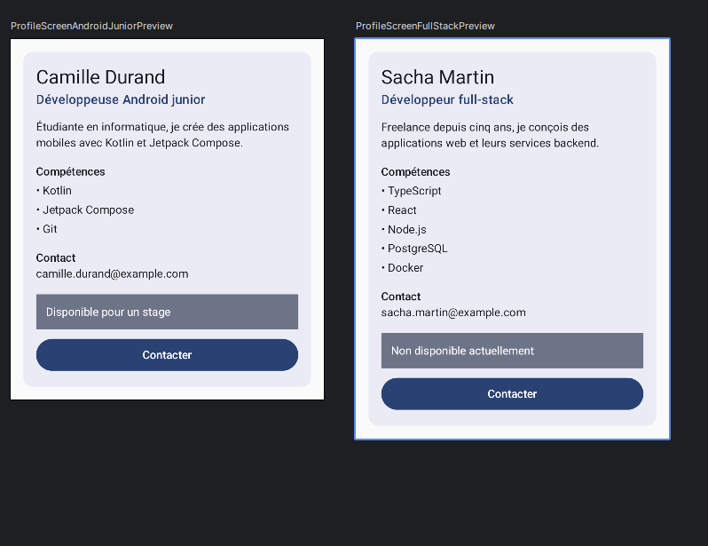

# Profil développeur Compose

## Description

Cette application Android affiche une fiche « Profil développeur » construite avec Jetpack Compose.
L'écran présente un nom, un rôle, une courte description, une liste de compétences et un contact.
Il propose aussi deux actions : une zone cliquable de disponibilité et un bouton « Contacter ».
Les données sont passées en paramètres, ce qui permet d'afficher plusieurs profils avec les mêmes composables.

## Notions utilisées

- composables ;
- paramètres ;
- modifiers et chaînage de modifiers ;
- padding externe / interne ;
- callbacks ;
- previews ;
- accessibilité de base.

## Explication

**1. Quels composables avez-vous créés ?**

`ProfileScreen`, `ProfileCard`, `ProfileHeader`, `SkillList`, `SkillItem`, `ProfileInfo`, `AvailabilityZone` et `ProfileAction`, ainsi que deux previews.

**2. Quel composable représente l'écran principal ?**

`ProfileScreen`, appelé depuis `MainActivity` dans le `Scaffold`.

**3. Où utilisez-vous un padding externe ?**

Dans `ProfileScreen`, qui place la fiche avec `modifier.fillMaxWidth().padding(16.dp)`. `ProfileCard` applique aussi un padding externe à ses enfants, par exemple `Modifier.padding(top = 16.dp)` sur `SkillList`. C'est le parent qui décide de l'espace autour du composant.

**4. Où utilisez-vous un padding interne ?**

Dans `ProfileCard`, avec le `Modifier.padding(16.dp)` de la `Column`, et dans `AvailabilityZone`, avec le `Modifier.padding(12.dp)` du `Text`. C'est le composant qui décide de l'espace entre son bord et son contenu.

**5. Quel composant reçoit un callback ?**

`AvailabilityZone` et `ProfileAction` reçoivent `onClick`. `ProfileScreen` et `ProfileCard` transmettent `onAvailabilityClick` et `onContactClick`. Les composants signalent le clic, et le parent décide quoi faire.

**6. Quelle information d'accessibilité avez-vous ajoutée ?**

`AvailabilityZone` est une zone cliquable personnalisée : elle déclare `role = Role.Button` et une `contentDescription` qui décrit l'action, par exemple « Proposer un stage à Camille Durand ». `ProfileAction` utilise un `Button`, qui expose déjà son rôle de bouton.

**7. Pourquoi vos composants peuvent-ils être considérés comme réutilisables ?**

Ils reçoivent leurs données et leurs callbacks en paramètres au lieu d'afficher des valeurs figées. Ils acceptent aussi un `modifier: Modifier = Modifier`, ce qui laisse le parent décider de leur placement. Les deux previews affichent ainsi deux profils différents avec le même code.

## Capture d'écran

